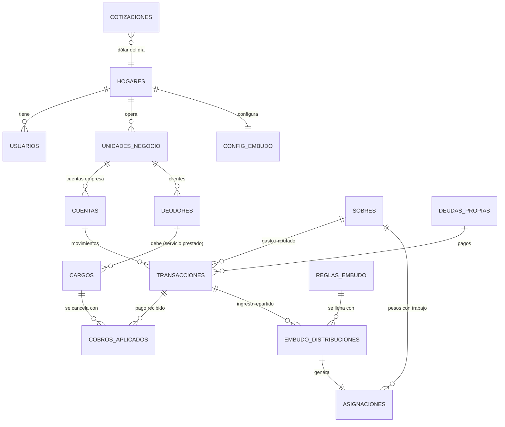

# Familianzas · Fase 1 — Arquitectura y Base de Datos

> App mobile-first para separar y ordenar la economía híbrida de una familia
> emprendedora rural: **pensionado equino**, **venta de alimento en hipódromos**
> y **cabañas turísticas**.

---

## 1. Principios de diseño

| # | Principio | Cómo se materializa |
|---|-----------|---------------------|
| 1 | **Separación estricta** | Cada cuenta, sobre y deuda pertenece a un `ambito` (`empresa` \| `familia`). La base de datos *rechaza* cualquier transferencia que cruce ámbitos si no es un `sueldo` (empresa→familia) o un `aporte_capital` (familia→empresa). No es una regla de la UI: es una regla del motor. |
| 2 | **Solo se presupuesta dinero que existe** | "Listo para asignar" se calcula sobre saldos reales. Las cuentas por cobrar se muestran como *esperado*, nunca como disponible. |
| 3 | **Offline primero** | El celular es la fuente de escritura; el servidor es la fuente de verdad consolidada. Los IDs se generan en el dispositivo. |
| 4 | **Dinero exacto** | Montos en centavos (`bigint`). Cero `float`. |
| 5 | **Libro mayor** | Los saldos no se guardan: se derivan de las transacciones. Una transferencia son dos movimientos que suman cero. |
| 6 | **Simple para usar en el campo** | Cargar un gasto debe tomar < 10 segundos y 3 toques, con o sin señal. |

---

## 2. Stack tecnológico

| Capa | Elección | Por qué |
|------|----------|---------|
| Framework | **Next.js 15 (App Router) + TypeScript** | Un solo código para web y móvil vía PWA instalable. Server Components para reportes, Client Components para la carga offline. |
| Estilos / UI | **Tailwind CSS + shadcn/ui** (Radix) | Componentes accesibles y livianos; theming por ámbito (azul empresa / verde familia) con variables CSS. |
| Backend | **Supabase** (Postgres + Auth + RLS + Edge Functions) | El dominio es *relacional y contable*: cobros parciales, transferencias de dos patas, vistas de antigüedad de deuda. Postgres permite poner las reglas de negocio en el motor (triggers, constraints) y reportes en SQL. Firestore obligaría a duplicar lógica en el cliente. |
| Base local | **Dexie.js** (IndexedDB) | Espejo local de las tablas + cola de salida (*outbox*). Consultas reactivas con `useLiveQuery`. |
| Service Worker | **Serwist** (sucesor de next-pwa) | Precache del "app shell" para abrir la app sin señal; Background Sync para vaciar la cola. |
| Estado UI | **Zustand** (toggle de ámbito, preferencias) + **TanStack Query** para lecturas online | |
| Validación | **Zod** | Mismo esquema valida formularios, la cola offline y las Edge Functions. |
| Gráficos | **Recharts** | Barras esperado vs. real, progreso de sobres. |
| Notificaciones | Web Push + link `wa.me` para recordatorios de cobro por WhatsApp | El canal real de cobranza en el campo. |
| Hosting | Vercel (front) + Supabase Cloud (región São Paulo) | Menor latencia desde Argentina. |
| Tests | Vitest (lógica de embudo/presupuesto), Playwright (flujos), pgTAP o SQL de prueba (reglas de BD) | |

### ¿Por qué no Firebase si trae offline "gratis"?

Firestore tiene caché offline nativa, pero:
- No hay transacciones multi-documento offline ni constraints: la regla "no mezclar fondos" quedaría solo en el cliente.
- Reportes como "morosidad por antigüedad" o "flujo esperado vs. real" requieren agregaciones que en Firestore implican Cloud Functions y documentos desnormalizados.
- El costo por lectura crece con dashboards que agregan mucho.

La desventaja de Supabase (no trae offline) se resuelve con la capa Dexie + outbox descrita abajo, que es ~300 líneas de código bien acotado. Alternativa evaluada para una fase posterior: **PowerSync** o **ElectricSQL**, que sincronizan Postgres↔SQLite automáticamente; la arquitectura propuesta es compatible con migrar a cualquiera de ellos.

---

## 3. Arquitectura general

```
┌──────────────────────── Celular / PWA ─────────────────────────┐
│  UI (Next.js + Tailwind)                                       │
│     │  escribe                         lee (reactivo)          │
│     ▼                                     ▲                    │
│  Repositorio local ──► Dexie (IndexedDB) ─┘                    │
│     │                    ├─ tablas espejo                      │
│     │                    └─ outbox (operaciones pendientes)    │
│     ▼                                                          │
│  Motor de Sync (online / Background Sync del Service Worker)   │
└─────┬──────────────────────────────────────────────▲───────────┘
      │ PUSH: upsert por lotes (idempotente por uuid)│ PULL: filas con
      ▼                                              │ actualizado_en > cursor
┌──────────────────────────── Supabase ─────────────────────────────┐
│  Postgres                                                         │
│   ├─ Tablas + RLS por hogar                                       │
│   ├─ Triggers: separación de ámbitos, transferencias balanceadas, │
│   │            estado de cargos                                   │
│   └─ Vistas: saldos, CxC con semáforo, flujo del mes,             │
│              listo para asignar, deudas priorizadas               │
│  Edge Functions: generar cuotas mensuales del pensionado,         │
│                  recordatorios de mora, cierre del Embudo         │
│  Auth: email mágico / Google (ambos cónyuges en el mismo hogar)   │
└───────────────────────────────────────────────────────────────────┘
```

### 3.1 Estrategia de sincronización offline

1. **IDs del cliente**: cada registro nace con `crypto.randomUUID()`. Reintentar un envío nunca duplica (upsert por `id`).
2. **Outbox**: toda escritura va primero a Dexie y a la tabla `outbox` (`{id, tabla, operacion, payload, intentos}`). La UI se actualiza al instante (optimista).
3. **Push**: al detectar conexión (`online` event + Background Sync), se envían lotes por tabla en orden de dependencias (cuentas → deudores → cargos → transacciones → cobros_aplicados). Las dos patas de una transferencia viajan **en el mismo RPC** porque la BD valida su balance al hacer commit.
4. **Pull incremental**: `select * from <tabla> where actualizado_en > :cursor` (índices ya creados). Se guarda un cursor por tabla.
5. **Conflictos**:
   - **Transacciones** son *append-only*: dos personas cargando gastos offline nunca chocan.
   - **Datos maestros** (deudores, sobres, deudas): *last-write-wins* por `actualizado_en`, aceptable para una familia de 2 usuarios.
   - **Bajas**: borrado lógico (`eliminado_en`) para que se propaguen.
   - **Duplicados de negocio**: `unique (deudor_id, periodo, concepto)` impide generar dos veces la cuota de noviembre del mismo cliente aunque ambos cónyuges la generen sin señal.
6. **Rechazos del servidor** (ej. alguien intentó mezclar fondos): la operación queda marcada en la outbox con el error y se muestra en una bandeja "Para revisar".

---

## 4. Modelo de datos

Archivo ejecutable: [`supabase/migrations/0001_esquema_inicial.sql`](../supabase/migrations/0001_esquema_inicial.sql)

### 4.1 Diagrama entidad-relación



### 4.2 Tablas

| Tabla | Rol | Campos clave |
|-------|-----|--------------|
| `hogares` | Tenant. Una familia = un hogar. | `moneda_base`, `estrategia_deuda` (avalancha / bola de nieve) |
| `usuarios` | Perfil 1:1 con `auth.users`. | `rol`, `modo_preferido` (recuerda el toggle) |
| `unidades_negocio` | Pensionado, Alimento, Cabañas. | `tipo`, `fecha_inicio` (inauguración de cabañas) |
| `cuentas` | Billeteras reales: caja, banco, Mercado Pago, dólares en efectivo, tarjeta. | **`ambito`**, `moneda`, `compartida` (tarjetas usadas para empresa y familia), `dia_cierre` |
| `cotizaciones` | Dólar blue del día: compra, venta y **promedio** (criterio dolarhoy.com). Automática + corrección manual. | `fecha`, `promedio`, `fuente` |
| `transacciones` | Libro mayor. Signo: + entra, − sale. | `tipo`, `monto`, `sobre_id`, `grupo_id` (transferencias), `deuda_id`, `moneda_original`/`monto_original`/`tipo_cambio`, `dispositivo_id` |
| `deudores` | Clientes de los negocios. | `tarifa_mensual`, `cantidad_unidades` (caballos), `dia_vencimiento`, `dias_gracia`, `telefono` |
| `cargos` | Servicio prestado / venta fiada / reserva. Lo que el cliente **debe**. | `monto`, `fecha_vencimiento`, `probabilidad_cobro`, `estado` (automático), `reserva_desde/hasta` |
| `cobros_aplicados` | Une un ingreso con uno o varios cargos. Permite pagos parciales y "te pago 3 meses juntos". | `monto` |
| `sobres` | Presupuesto base cero + metas. Tipos: gasto mensual, costo fijo, fondo de emergencia, ahorro, inversión, impuestos, deuda. | `ambito`, `meta_monto`, `meta_mensual`, `prioridad` |
| `asignaciones` | Cada vez que se le da un trabajo a un peso. | `sobre_id`, `mes`, `monto` (± para mover) |
| `deudas_propias` | Lo que la familia/empresa debe: préstamos, tarjetas, **compras en cuotas**, **plan de ahorro (Hilux)**. | `tipo`, `tasa_anual` (TNA), `pago_minimo` (= cuota), `cuotas_total`, `cuenta_tarjeta_id`, `sobre_id` |
| `config_embudo` | Modo (**forzar** por defecto), sobre "Sueldo por transferir", cuenta familiar destino. | |
| `reglas_embudo` | La cascada de prioridades: en qué orden se llena cada cosa con cada peso que entra. | `orden`, `destino` (sobre / sueldo), `tope_mensual`, `porcentaje_max` |
| `embudo_distribuciones` | Cómo se repartió cada ingreso (auditable, no se reparte dos veces). | `transaccion_ingreso_id`, `regla_id`, `monto` |

> **Nota de mapeo con lo pedido:** *Usuarios* → `usuarios`; *Transacciones* → `transacciones` (+ `cobros_aplicados`); *Unidades_Negocio* → `unidades_negocio`; *Deudores* → `deudores` + `cargos`; *Deudas_Propias* → `deudas_propias`. Se agregan `cuentas`, `cotizaciones`, `sobres`, `asignaciones` y las del Embudo porque sin ellas no hay separación real ni presupuesto base cero.

### 4.3 Reglas de negocio en la base de datos

| Regla | Mecanismo |
|-------|-----------|
| Una transacción hereda el ámbito de su cuenta (el cliente no puede mentir). | Trigger `trx_validar_ambito` |
| Un gasto de empresa no puede imputarse a un sobre familiar (y viceversa). | Trigger `trx_validar_ambito` |
| Transferencia = exactamente 2 patas que suman 0. | Constraint trigger diferido `trx_validar_transferencia` |
| `transferencia` solo dentro del mismo ámbito; `sueldo` solo empresa→familia; `aporte_capital` solo familia→empresa. | Ídem |
| Estado del cargo (`pendiente`/`parcial`/`pagado`) se recalcula solo. | Trigger `cargo_recalcular_estado` |
| No duplicar la cuota mensual de un cliente. | `unique (deudor_id, periodo, concepto)` |
| Tarjeta compartida: cada gasto debe decir si es de empresa o familia (lo toma del sobre), y cada parte paga **su** parte del resumen. | Trigger `trx_validar_ambito` + regla de transferencias |
| No repartir dos veces el mismo ingreso en el Embudo. | `unique (transaccion_ingreso_id, regla_id)` |
| Cada hogar ve solo sus datos. | RLS con `mi_hogar()` en todas las tablas |

Estas reglas fueron probadas contra Postgres 16 (ver `supabase/tests/reglas_negocio.sql`).

### 4.4 Vistas que alimentan la app

| Vista | Responde |
|-------|----------|
| `v_saldo_cuentas` | ¿Cuánto hay realmente en cada cuenta? |
| `v_cuentas_por_cobrar` | ¿Quién me debe, cuánto y hace cuánto? Semáforo: `al_dia`, `gracia`, `atrasado` (≤30 d), `moroso` (≤60 d), `critico`. |
| `v_flujo_mes` | Por unidad de negocio, todo en pesos: **esperado** (pendiente × probabilidad de cobro) vs. **cobrado real** vs. gastado (los dólares se convierten a la cotización usada o la vigente). |
| `v_sobres_disponible` | Por sobre: asignado, gastado y disponible (con arrastre de meses anteriores, como YNAB). |
| `v_tarjetas_por_ambito` | De cada tarjeta: cuánto debe la empresa y cuánto la familia. |
| `v_listo_para_asignar` | Por ámbito: pesos reales − asignado a sobres − compras con tarjeta aún no pagadas. Si es > 0 hay pesos "sin trabajo"; si es < 0 se gastó plata que no había. Muestra aparte los dólares sin convertir. |
| `v_embudo_mes` | Avance de cada regla del Embudo en el mes: cubierto y lo que falta (incluye "sueldo que la empresa todavía le debe a la familia"). |
| `v_deudas_priorizadas` | Saldo actual, interés mensual estimado y orden de pago según avalancha (mayor tasa) o bola de nieve (menor saldo). |

---

## 5. Lógica de los módulos core (resumen)

### 5.1 El Embudo (sueldo FORZADO con prioridades)

Decisión: **forzado**, pero sin vaciar el negocio. Cada peso que entra a la
empresa recorre una lista ordenada de reglas; cada regla tiene un **tope
mensual** y se llena antes de pasar a la siguiente:

```
Entra un cobro de $500.000 ─▶ 1. Reponer alimento (stock)   tope 900.000  → toma 500.000 ✔ lleno parcial
                              2. Sueldo mínimo               tope 600.000  → espera el próximo cobro
Entra otro de $800.000     ─▶ 1. Reponer alimento            falta 400.000 → toma 400.000 ✔ lleno
                              2. Sueldo mínimo               falta 600.000 → toma 400.000
...
```

- Las reglas las ordena la familia (arrastrando en la pantalla). El sueldo puede
  partirse en dos: **sueldo mínimo** (alto en la lista) y **sueldo completo** (más abajo).
- Opcional `porcentaje_max`: "de cada cobro, como mucho 40% para esta regla",
  para que un solo cobro grande no se lo lleve todo una regla.
- Lo que se asigna a una regla de sueldo va al sobre de empresa **"Sueldo por
  transferir"**: queda bloqueado para el negocio *en el momento*, aunque la plata
  física se mueva después. La app muestra "Pasá $X a la cuenta familiar" y al
  confirmar se registra el `sueldo`.
- Lo que falta de sueldo a fin de mes se muestra como **"la empresa le debe a la
  familia $X"**: es la señal de que el negocio no está sosteniendo a la casa.

### 5.2 Presupuesto base cero

- Cuando entra el sueldo a la billetera familiar, aparece en "Listo para asignar".
- El usuario (o un "auto-asignar" por `prioridad`) reparte: primero necesidades del bebé/hijos y casa, luego pago mínimo de deudas, luego fondo de emergencia, luego deuda extra (según estrategia), luego ahorro.
- Nunca se asigna dinero de cuentas por cobrar.

### 5.3 Deudas

- Interés mensual estimado = saldo × TNA / 12. (Para tarjetas argentinas se puede cargar TEA→TNA en la UI.)
- Compras en cuotas y plan Hilux: cada mes la cuota se registra como `pago_deuda` sobre la tarjeta que la debita, imputada a su sobre. Así baja la deuda, sube el resumen de la tarjeta y se ve cuántas cuotas faltan.
- El simulador (Fase 3) proyecta mes a mes con el "pago extra" disponible y compara avalancha vs. bola de nieve en meses y en intereses totales.

---

## 6. Decisiones tomadas

| Tema | Decisión |
|------|----------|
| **Dólares** | Cuentas en USD (ej. "Dólares Alimento"). Un cobro en dólares entra a esa cuenta; al venderlos se registra una conversión USD→ARS con el **promedio blue** (compra+venta)/2, criterio dolarhoy.com. Si cambian al instante, se carga directo en pesos guardando `monto_original` en USD. Los dólares **no se reparten** en sobres hasta convertirlos; se muestran aparte. La cotización la trae una Edge Function una vez por día (desde una API pública con los mismos valores que dolarhoy.com, ya que el sitio no tiene API); sin señal se usa la última, y se puede corregir a mano. |
| **Tarjetas** | Una tarjeta puede ser **compartida**. Cada gasto se marca empresa o familia (lo define el sobre: "Nafta y peajes" es de empresa, "Súper" es de familia). Al pagar el resumen, cada lado paga lo suyo; la familia no puede pagar la parte de la empresa ni al revés. Las compras en cuotas (materiales de cabañas) y el plan Hilux son deudas con cuotas debitadas en la tarjeta. Al gastar con tarjeta, la plata queda **apartada** en la cuenta para pagar el resumen (el método "cada peso tiene un trabajo"). |
| **Sueldo** | **Forzado** con cascada de prioridades y topes mensuales (ver 5.1). |
| Facturación / AFIP | Fuera de alcance por ahora; se cubre con un sobre de impuestos dentro del Embudo. |
| Hijos | No son usuarios; se representan con grupos de sobres ("Hijo mayor", "Bebé"). |

## 7. Estructura del repositorio (propuesta)

```
familianzas/
├─ docs/                         # documentación de fases
├─ supabase/
│  ├─ migrations/0001_esquema_inicial.sql
│  └─ tests/reglas_negocio.sql
└─ (Fase 3) app Next.js
   ├─ app/(empresa)/…  app/(familia)/…
   ├─ lib/dominio/      # embudo.ts, presupuesto.ts, deudas.ts (puro, testeable)
   ├─ lib/offline/      # dexie.ts, outbox.ts, sync.ts
   └─ components/
```
